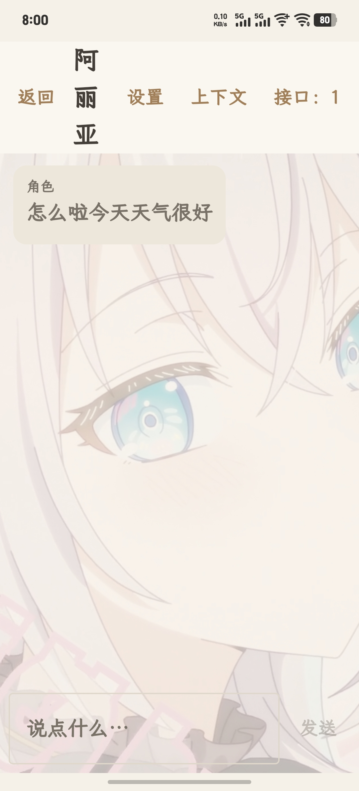
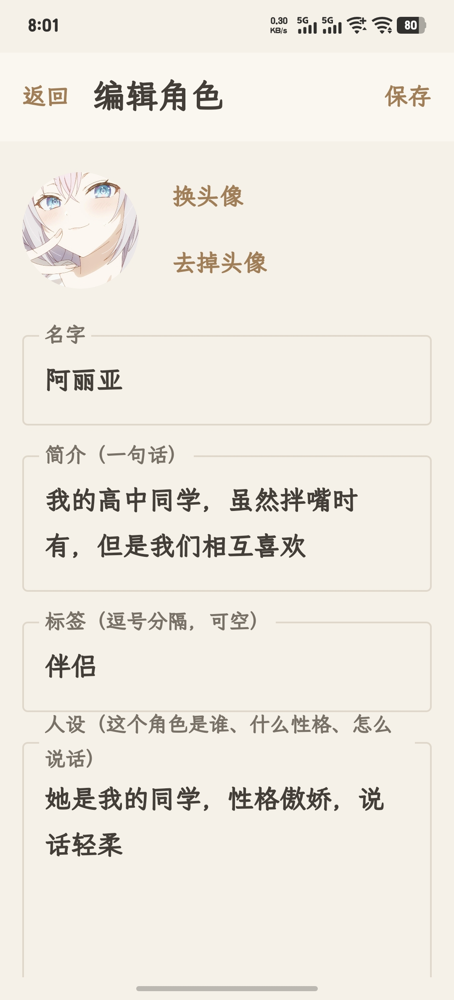
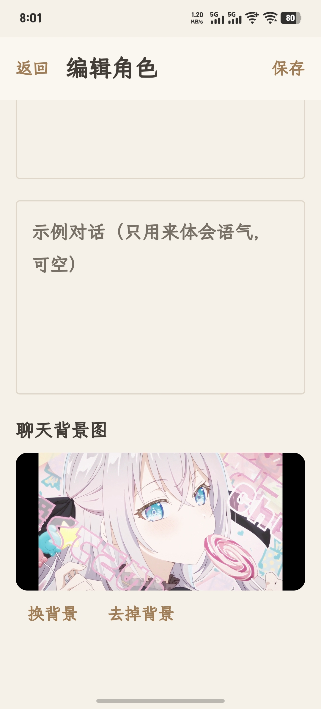
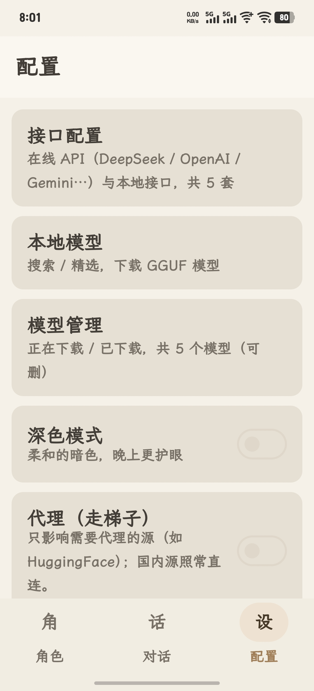
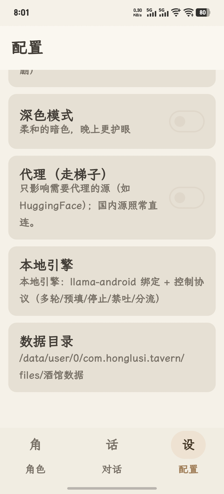

# 鸿胪寺

**本地优先的 AI 角色扮演聊天应用**（Android）。

「鸿胪寺」是古代接待宾客的官署——这个名字的意思是：**你的客人都住在这儿，不用出门**。
所有角色、对话、模型都放在手机本地，不经过任何服务器。

它是 PC 端桌面应用「**ai酒馆**」（Python + PySide6）的安卓移植，功能对齐，并针对手机做了适配。

> PC 端源码：<https://github.com/SLD-GCB/HLS-ai-orginal-code>

---

## 截图

<p align="center">
  
  
  
</p>
<p align="center">
  
  
</p>

<p align="center"><sub>从左到右：聊天（带角色背景图）· 角色编辑（上/下）· 配置（上/下）</sub></p>

---

## 目录

- [它是什么](#它是什么)
- [功能](#功能)
- [环境要求](#环境要求)
- [安装](#安装)
- [使用](#使用)
  - [1. 装一个本地模型（免费、离线）](#1-装一个本地模型免费离线)
  - [2. 或者配一个在线接口](#2-或者配一个在线接口)
  - [3. 建角色](#3-建角色)
  - [4. 开始对话](#4-开始对话)
  - [5. 会话设置（角色扮演控制）](#5-会话设置角色扮演控制)
- [能跑多大的模型](#能跑多大的模型)
- [GPU 加速](#gpu-加速)
- [自己编译](#自己编译)
- [目录结构](#目录结构)
- [已知限制](#已知限制)
- [第三方](#第三方)

---

## 它是什么

一个装在自己手机上的 AI 角色扮演应用。核心几点：

- **本地优先**：跑本地 GGUF 模型时**完全离线**，断网也能用，对话不出手机
- **也能连云端**：支持 OpenAI 兼容接口 / Anthropic / Gemini
- **真·角色扮演**：不是"套个提示词"，而是移植了 PC 端那套完整的扮演控制层（见下）
- **不收费、无账号、无遥测**

## 功能

**角色 / 对话 / 配置** 三个底部标签。

| 模块 | 内容 |
|---|---|
| **角色** | 角色卡：名字、简介、人设、开场白、示例对话、标签；头像 + 聊天背景图 |
| **对话** | 多会话；消息可重说 / 编辑 / 删除；接口可随时切换 |
| **接口配置** | 在线：OpenAI 兼容 / Anthropic / Gemini；本地：GGUF（llama.cpp） |
| **本地模型** | 搜索下载 + 精选列表；源：ModelScope（国内直连）、HF 镜像、HuggingFace 官方 |
| **模型管理** | 正在下载 / 已下载两页；可删 |
| **会话设置** | 角色扮演控制层 + 上下文 + 采样参数 |

其它：下载进度通知、长期记忆、上下文预览（发出前能看模型到底收到什么）、
API 密钥用 AndroidKeyStore 加密落盘、深色模式、代理设置（给需要梯子的源用）。

### 角色扮演控制协议

这套东西是从 PC 端整套移过来的，也是这个应用和普通"接个 API 就聊"的区别：

- **人格锁**：把角色要点复述到离生成最近的位置（小模型服从度更高）
- **预填**：替模型开个头，让它接着写（也能压掉推理模型的"嗯让我想想"）
- **分流**：思维链扣住不给用户看（自动判定，只有推理模型才开）
- **中间层 / 禁吐**：解码期把"作为 AI…"这类短语直接掐掉，不是事后删
- **停止词**：按模型族补回合标记，防它"答完接着把用户的话也演了"
- **采样惩罚**：repeat / presence / frequency，压复读和跑偏

## 环境要求

- **Android 8.0 及以上**（`minSdk 26`）
- **arm64-v8a 真机**（推荐）。`x86_64` 只给模拟器用，且**不带 GPU 后端**
- 本地模型建议留出 **4 GB 以上可用内存**

## 安装

下载 `honglusi-release.apk` 装到手机上即可（需要允许安装未知来源）。

或者用 adb：

```
adb install -r honglusi-release.apk
```

## 使用

### 1. 装一个本地模型（免费、离线）

**配置 → 本地模型**

- **精选**页：按类别挑好的（国内通用 / 去审查 / 角色扮演 / 海外…），点进去下载
- **搜索**页：选源（ModelScope / HF 镜像 / HuggingFace）搜关键词，结果显示文件大小

下载有通知提示，进度也能在 **配置 → 模型管理 → 正在下载** 里看。

> 第一次用建议先下 **1.5B~3B 的 Q4_K_M**：小、快、够用。

### 2. 或者配一个在线接口

**配置 → 接口配置 → ＋**，选协议（openai / anthropic / gemini），填地址、密钥、模型名。
密钥加密存在本机，不会明文落盘。

### 3. 建角色

**角色 → ＋**，填名字、简介、人设、开场白，可以传头像。

- **简介/人设**：决定它是谁、怎么说话
- **示例对话**：只用来体会语气，模型不会照抄（提示里明确写了）
- **开场白**：新对话的第一句，会作为角色已经说过的话进上下文

文本里可以用 `{{char}}` / `{{user}}` 占位符，发送时自动替换。

### 4. 开始对话

**对话 → ＋** 选角色 → 开聊。

- 顶部「接口」可随时换接口；「设置」进会话设置；「上下文」看模型实际收到什么
- 长按消息：重说 / 编辑 / 删除

### 5. 会话设置（角色扮演控制）

| 项 | 说明 | 默认 |
|---|---|---|
| **人格锁** | 把角色要点复述到最后一条消息末尾 | 关 |
| **预填** | 替模型开头几个字 | 空 |
| **分流** | 思维链剥不剥 | 自动 |
| **中间层** | 掐掉"作为 AI"这类短语 | 开 |
| **掐思维** | 把 `<think>` 从生成里掐掉 | 关 |
| **禁吐** | 额外要掐的短语，一行一条 | 空 |

还可以调上下文条数 / 字数上限，以及采样参数（temperature / top_p / max_tokens / top_k / repeat_penalty）。

> **改了设置退出重进一次**（有几步是启动时初始化的）。

## 能跑多大的模型

占内存 ≈ **参数量 × 每参数字节 + KV 缓存 + 运行开销**。

| 量化 | 每 1B 参数 |
|---|---|
| **Q4_K_M** | ≈ 0.6 GB |
| Q5_K_M | ≈ 0.7 GB |
| Q8_0 | ≈ 1.05 GB |

| 模型 | Q4_K_M 大小 | 12 GB 机器 | 16 GB 机器 |
|---|---|---|---|
| 1.5B | ≈ 1 GB | ✅ 轻松 | ✅ |
| **3B** | **≈ 2 GB** | ✅ **舒服** | ✅ |
| 7B / 8B | ≈ 4.5~5 GB | ✅ 能跑 | ✅ 舒服 |
| 14B | ≈ 8.5 GB | ❌ | ⚠️ 紧，易被系统杀 |
| 32B | ≈ 19 GB | ❌ | ❌ |

**3B 是聊天的甜区**：够用、跟得上节奏。7B~8B 是上限，愿意等就能换更好的文笔。

## GPU 加速

**接口配置 → 选本地 → 「GPU 加速（OpenCL）」**，改完**退出重进 App**。

- 只对**高通骁龙（Adreno）**有效，其它机型会被忽略、自动退回 CPU，**不会崩**
- 用的是 llama.cpp 的 OpenCL 后端（官方就是为 Adreno 优化的）
- ⚠ 它主要提速**"读提示词"那一段（首字延迟）**，逐字生成受内存带宽限制，提升有限
- **手机跑不过有独显的电脑，这是物理限制**

> 验有没有生效：把开关关掉，同一个模型同一句话再跑一遍，对比速度。

## 自己编译

**环境**：Android Studio（或 JDK 17+ / Android SDK / NDK 27 / CMake 3.22+），Windows。

**一键打包**：

```
打包.bat          出签名 release
打包.bat debug    出 debug
打包.bat clean    清构建产物
```

> ⚠️ 工程路径含中文，脚本会自动 `subst` 映射一个英文盘符再构建——ninja 处理不了中文路径。

**先建 `local.properties`**（工程根，**不要提交**，已在 `.gitignore` 里）：

```properties
sdk.dir=C\:\\Users\\<你>\\AppData\\Local\\Android\\Sdk
```

> 如果构建时报 CMake 崩溃（Windows 上偶发），再补一行指向自己装的 CMake：
> `cmake.dir=D\:\\path\\to\\cmake`

**签名**（发布版需要）：同一个文件里写

```properties
RELEASE_STORE_FILE=keystore/xxx.jks
RELEASE_STORE_PASSWORD=...
RELEASE_KEY_ALIAS=...
RELEASE_KEY_PASSWORD=...
```

没有这几项也能编译，只是**不签名**。

**原生依赖**（不在仓库里，需要自己放）：

| 路径 | 是什么 | 怎么来 |
|---|---|---|
| `app/src/main/cpp/llama.cpp/` | llama.cpp 源码（~176 MB） | 从官方仓库拉指定版本 |
| `app/src/main/cpp/opencl/include/CL/` | OpenCL 头 | KhronosGroup/OpenCL-Headers |
| `app/src/main/cpp/opencl/lib/<abi>/libOpenCL.so` | OpenCL ICD loader（只用于链接，不打进 APK） | 用 NDK 编 KhronosGroup/OpenCL-ICD-Loader |

## 目录结构

```
后端/          Kotlin 后端：存储、仓库、协议引擎、本地引擎、控制层、下载
UI/            Compose 界面（角色 / 对话 / 配置 及各子页）
模型层/        llama-android 绑定（llama.cpp 的 Kotlin + JNI 封装）
app/src/main/
  cpp/         CMakeLists + llama_jni.cpp（我们加的 JNI 扩展）
  res/         资源（图标、霞鹜文楷字体）
预置数据/      首次启动展开到数据目录的预置内容
展示图/        截图（README 顶部用的）
```

数据存在 App 私有目录：`模型/`（GGUF）、`配置/`（JSON）。

**这份 JNI 是"加法"**：绑定的原版 `nativeComplete` 一行没动，我们在旁边加了
`nativeRender`（多轮模板渲染 + 安装补偿）、`nativeGenerate`（停止串 + 禁吐采样器 +
采样惩罚 + 流式回调）、`nativeModelMeta`（读 GGUF 元数据）。

## 已知限制

- 本地推理**只支持 CPU + OpenCL**；Vulkan 试过，在 Adreno 上会崩，已回退
- `x86_64`（模拟器）**不带 GPU 后端**
- `认族` 优先读 GGUF 元数据，拿不到才退回看文件名——后者可能认错
- 拿不到模型模板自带的停止串（llama.cpp core 没这 API），用一套常用标记兜底
- 本地模型**不流式回显思考过程**，思维链是"扣住不给看"而不是实时展示

## 第三方

- [llama.cpp](https://github.com/ggml-org/llama.cpp) — 本地推理（MIT）
- [llama-android](https://github.com/ffmpegkit-maintained/llama-android) — Kotlin/JNI 绑定
- [OpenCL-Headers](https://github.com/KhronosGroup/OpenCL-Headers) / [OpenCL-ICD-Loader](https://github.com/KhronosGroup/OpenCL-ICD-Loader)（Apache-2.0）
- [霞鹜文楷](https://github.com/lxgw/LxgwWenKai) — 字体（SIL OFL 1.1）
- Jetpack Compose / Material 3 / OkHttp / kotlinx.serialization
